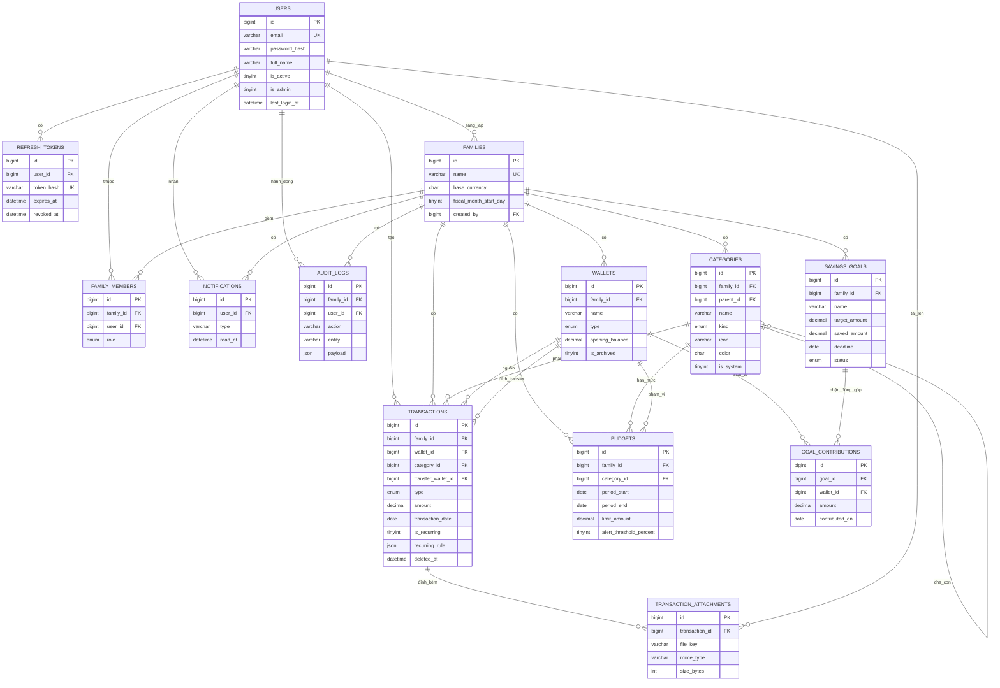

# ERD — Mô hình quan hệ dữ liệu Family Finance Manager
**Thẻ backlog:** DB-01 · **Chịu trách nhiệm:** Thành (Database & Data Lead) · **Đối chiếu:** `backend/src/main/resources/db/migration/V1__init_schema.sql`

## 1. Sơ đồ quan hệ (Mermaid — GitHub/GitLab render trực tiếp)



*(Ảnh render: vào `docs/ERD.md` trên GitHub → Tab "Preview", hoặc xuất bằng https://mermaid.live → Save SVG, nhúng vào báo cáo final Sprint 4.)*

## 2. Từ điển dữ liệu (các bảng chính)

| Bảng | Mục đích | Khóa | Ghi chú thiết kế |
|---|---|---|---|
| `users` | Tài khoản đăng nhập | PK `id`, UK `email` | `is_admin` tách khỏi vai trò trong hộ; `password_hash` bcrypt 60 ký tự |
| `families` | Hộ gia đình (tenant) | PK `id`, UK `name` | `fiscal_month_start_day` cho phép kỳ kế toán không bắt đầu ngày 1 |
| `family_members` | Quan hệ nhiều-nhiều + vai trò | UK `(family_id, user_id)` | role: `OWNER/ADMIN/MEMBER/VIEWER` |
| `categories` | Danh mục thu/chi theo hộ | UK `(family_id, kind, name)` | cây 2 cấp qua `parent_id`; `is_system=1` là danh mục template |
| `wallets` | Nguồn tiền | UK `(family_id, name)` | `opening_balance` là điểm tựa để tính số dư |
| `transactions` | Giao dịch | PK `id` | `CHECK (amount>0)`; soft delete; `TRANSFER` có `transfer_wallet_id` |
| `transaction_attachments` | Ảnh hóa đơn | PK `id` | file lưu disk/S3, DB chỉ giữ `file_key` |
| `budgets` | Hạn mức chi | UK `(family_id, category_id, period_start)` | chỉ dùng cho `kind=EXPENSE` |
| `savings_goals` | Mục tiêu tiết kiệm | PK `id` | `saved_amount` cập nhật khi có `goal_contributions` |
| `goal_contributions` | Lịch sử đóng góp | PK `id` | giữ `wallet_id` để hoàn tác được |
| `refresh_tokens` | Phiên đăng nhập | UK `token_hash` | hash SHA-256, rotation mỗi lần refresh |
| `notifications` | Cảnh báo ngân sách | — | `read_at` rỗng = chưa đọc |
| `audit_logs` | Lịch sử thao tác | — | `payload JSON` diff trước/sau |

## 3. Index phục vụ báo cáo (NFR-05)

| Index | Bảng | Query được phục vụ |
|---|---|---|
| `idx_tx_family_date` | transactions (family_id, transaction_date) | tổng thu/chi theo kỳ của hộ |
| `idx_tx_wallet_date` | transactions (wallet_id, transaction_date) | số dư ví tại một mốc thời gian |
| `idx_tx_category_date` | transactions (category_id, transaction_date) | cơ cấu chi theo danh mục |
| `idx_bg_family_period` | budgets (family_id, period_start, period_end) | so sánh chi thực tế với hạn mức |
| `uq_category_name`, `uq_wallet_name` | categories, wallets | chống trùng tên trong cùng hộ |

## 4. Truy vấn nghiệm thu (dùng khi kiểm tra AC-02, AC-03)

```sql
-- Tổng thu / tổng chi / kết dư của hộ 1 trong tháng 10/2026
SELECT t.type, SUM(t.amount) AS total
FROM transactions t
WHERE t.family_id = 1
  AND t.transaction_date BETWEEN '2026-10-01' AND '2026-10-31'
  AND t.deleted_at IS NULL
  AND t.type <> 'TRANSFER'
GROUP BY t.type;

-- Cơ cấu chi theo danh mục (top 5) — nuôi biểu đồ tròn dashboard
SELECT c.name, SUM(t.amount) AS spent
FROM transactions t JOIN categories c ON c.id = t.category_id
WHERE t.family_id = 1 AND t.type = 'EXPENSE'
  AND t.transaction_date BETWEEN '2026-10-01' AND '2026-10-31'
  AND t.deleted_at IS NULL
GROUP BY c.name ORDER BY spent DESC LIMIT 5;

-- Ngân sách đã dùng bao nhiêu % (AC-03)
SELECT c.name, b.limit_amount, COALESCE(SUM(t.amount),0) AS used,
       ROUND(COALESCE(SUM(t.amount),0) / b.limit_amount * 100, 1) AS percent
FROM budgets b
JOIN categories c ON c.id = b.category_id
LEFT JOIN transactions t ON t.category_id = b.category_id
       AND t.family_id = b.family_id AND t.type = 'EXPENSE' AND t.deleted_at IS NULL
       AND t.transaction_date BETWEEN b.period_start AND b.period_end
WHERE b.family_id = 1 AND b.period_start = '2026-10-01'
GROUP BY c.name, b.limit_amount;

-- Số dư ví = số dư đầu + thu - chi +/- transfer
SELECT w.name,
       w.opening_balance
       + COALESCE(SUM(CASE WHEN t.type='INCOME'  THEN t.amount ELSE 0 END), 0)
       - COALESCE(SUM(CASE WHEN t.type='EXPENSE' THEN t.amount ELSE 0 END), 0)
       - COALESCE(SUM(CASE WHEN t.type='TRANSFER' AND t.wallet_id = w.id THEN t.amount ELSE 0 END), 0)
       + COALESCE(SUM(CASE WHEN t.type='TRANSFER' AND t.transfer_wallet_id = w.id THEN t.amount ELSE 0 END), 0) AS balance
FROM wallets w LEFT JOIN transactions t ON t.family_id = w.family_id AND t.deleted_at IS NULL
WHERE w.family_id = 1 GROUP BY w.id, w.name;
```

## 5. Quyết định thiết kế & trade-off
| Quyết định | Lý do | Đánh đổi |
|---|---|---|
| Multi-tenant theo `family_id` trong từng bảng (không tách schema) | đơn giản, đủ cho quy mô lớp học | mọi query phải nhớ điều kiện `family_id` (bọc trong repository layer) |
| Số dư ví **tính suy ra**, không lưu cột chạy | tránh lệch dữ liệu khi sửa/xóa giao dịch | query nặng hơn → cache Caffeine theo `(family, month)` |
| `TRANSFER` là một bản ghi, không hai | báo cáo thu/chi không bị nhiễu | SQL số dư phải xử lý 2 chiều |
| Soft delete giao dịch | nghiệp vụ hoàn tác + audit | mọi câu truy vấn thêm `deleted_at IS NULL` |
| Danh mục riêng theo hộ | hộ khác nhau habits chi tiêu khác nhau | cần seed template khi tạo hộ (Q-03) |
