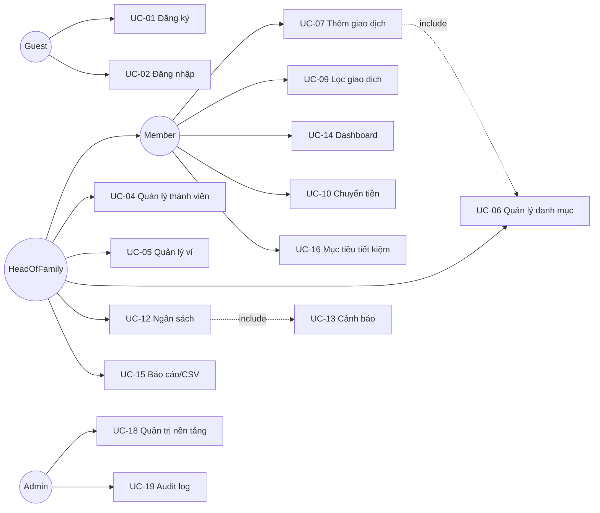

# ĐẶC TẢ YÊU CẦU HỆ THỐNG (SRS)
## Hệ thống Quản lý Thu chi Cá nhân và Hộ gia đình — Family Finance Manager

| Hạng mục | Nội dung |
|---|---|
| Học phần | Phát triển Dự án Phần mềm / Đồ án Chuyên ngành |
| Lớp học phần | HN-KS24-CNTT1 |
| Nhóm | Nhóm 05 (05 thành viên) |
| Đề tài | Đề tài 10 — Personal Finance Management |
| Giảng viên hướng dẫn | ThS. Bùi Thanh Hải |
| Phiên bản tài liệu | 1.0 — Sprint 1 |
| Ngày cập nhật | 22/10/2026 |
| Trạng thái | Draft — chờ Giảng viên duyệt |

**Người chịu trách nhiệm tài liệu:** Nguyễn Tiến Cường (An) — Leader/Backend Lead.
**Tham chiếu:** [`ERD.md`](ERD.md) · [`api.md`](api.md) · [`sprint1-checklist.md`](sprint1-checklist.md) · `Ke_Hoach_Do_An_Nhom05_DeTai10.xlsx` (sheet Backlog, RACI).

---

## 1. GIỚI THIỆU

### 1.1 Mục đích tài liệu
Tài liệu này đặc tả hóa yêu cầu chức năng và phi chức năng của hệ thống **Family Finance Manager**, dùng làm:
- căn cứ để nhóm triển khai theo Sprint và để nghiệm thu,
- căn cứ để Giảng viên đánh giá phạm vi đề tài,
- "hợp đồng" giữa tầng Frontend và Backend (cùng với [`api.md`](api.md)).

### 1.2 Phạm vi hệ thống
Hệ thống ghi nhận **giao dịch thu/chi** theo từng **hộ gia đình**, tổng hợp theo **danh mục**, **ví/tài khoản** và **tháng/quý/năm**; cho phép đặt **ngân sách** và **mục tiêu tiết kiệm**, cảnh báo khi sắp/vượt hạn mức, hiển thị dashboard biểu đồ và xuất báo cáo CSV.

### 1.3 Định nghĩa và viết tắt
| Viết tắt | Ý nghĩa |
|---|---|
| FFMS | Family Finance Manager — hệ thống đang đặc tả |
| Hộ gia đình (Household) | Nhóm người dùng dùng chung dữ liệu thu chi, có chủ hộ |
| Ví (Wallet) | Nguồn tiền: tiền mặt, ngân hàng, ví điện tử, tiết kiệm, thẻ tín dụng |
| Danh mục (Category) | Nhóm chi/thu, có cây cha–con, thuộc một hộ |
| Ngân sách (Budget) | Hạn mức chi cho một danh mục trong một chu kỳ thời gian |
| REST API | Giao tiếp HTTP/JSON, tài nguyên theo `/api/v1/...` |
| JWT | Access token 15 phút + Refresh token 30 ngày |
| MoSCoW | Ưu tiên Must / Should / Could / Won't |

### 1.4 Tài liệu tham chiếu
1. `Bao_Cao_De_Cuong_Nhom05_DeTai10.docx` — Đề cương dự án sơ bộ (bản nộp 23/10/2026).
2. `Ke_Hoach_Do_An_Nhom05_DeTai10.xlsx` — Backlog 30 thẻ, phân công RACI, tiến độ, rủi ro, nghiệm thu.
3. Đề bài: *Hệ thống quản lý thu chi cá nhân và gia đình — Personal Finance Management*.

---

## 2. MÔ TẢ TỔNG QUAN

### 2.1 Bối cảnh và vấn đề
Các gia đình nhỏ hiện ghi chi tiêu bằng sổ tay hoặc tin nhắn, dẫn tới ba vấn đề: (1) không biết tiền đã chảy vào danh mục nào, (2) không có hạn mức nên vượt chi cuối tháng, (3) không theo dõi được khoản tiết kiệm dài hạn. FFMS giải quyết bằng ghi nhận nhanh (dưới 15 giây/giao dịch), đối soát theo hộ gia đình và cảnh báo tự động.

### 2.2 Actor và vai trò
| Actor | Mô tả | Quyền chính |
|---|---|---|
| **Guest** | Người chưa đăng nhập | Xem landing, đăng ký/đăng nhập |
| **Member** (thành viên hộ) | Người được chủ hộ mời | Thêm/sửa/xóa giao dịch **do mình tạo**, xem báo cáo chung, tạo mục tiêu |
| **HeadOfFamily** (chủ hộ) | Người tạo hộ | Toàn quyền Member + quản lý ví/danh mục/ngân sách, mời–gỡ thành viên, xuất dữ liệu |
| **Admin** (quản trị nền tảng) | Thành viên nhóm được gán `is_admin` | Quản lý user/hộ, khóa tài khoản, xem log hệ thống, cấu hình danh mục mặc định |

Một user có thể thuộc nhiều hộ; mọi truy vấn nghiệp vụ luôn có `family_id` trong điều kiện (multi-tenant theo hộ).

### 2.3 Môi trường triển khai
| Môi trường | Mô tả | Cổng |
|---|---|---|
| dev (local) | `docker compose up` trên máy thành viên | web 5173, app 8090, mysql 3307, adminer 8081 |
| staging | VPS Ubuntu, nhánh `develop` tự deploy qua GitHub Actions | 80/443 qua Nginx |
| production | VPS, nhánh `main` | 443 HTTPS (certbot) |

### 2.4 Ràng buộc
- **CL-01** Ngân sách thời gian: 4 sprint, 12 ngày (20/10 → 01/11/2026).
- **CL-02** Bắt buộc đủ 3 lớp: Backend + Frontend + DevOps (điều kiện đề bài).
- **CL-03** Sinh viên dùng tài nguyên miễn phí: GitHub Free, GHCR, VPS đã có, không dùng dịch vụ trả phí.
- **CL-04** Tiền lưu `DECIMAL(15,2)`, đơn vị VND, không dùng số thực dấu phẩy động.
- **CL-05** Không thu thập dữ liệu nhạy cảm beyond cần thiết (không lưu CCCD, không lưu số thẻ ngân hàng đầy đủ).
- **CL-06** Browser mục tiêu: Chrome/Edge 2 bản gần nhất, responsive ≥ 375px.

### 2.5 Giả định và phụ thuộc
- Mỗi hộ có ≤ 8 thành viên, ≤ 200 giao dịch/tháng trong dữ liệu demo.
- Không tích hợp thật với ngân hàng (chỉ mô phỏng, theo đúng phạm vi đề bài).
- Ảnh minh chứng pipeline/board cần chụp trước 01/11/2026.

---

## 3. YÊU CẦU CHỨC NĂNG

### 3.1 Danh sách use case
| Mã | Use case | Actor | Ưu tiên | Sprint | Thẻ backlog |
|---|---|---|---|---|---|
| UC-01 | Đăng ký tài khoản | Guest | Must | S2 | BE-03, FE-03 |
| UC-02 | Đăng nhập / đăng xuất / làm mới token | Guest, Member | Must | S2 | BE-03, FE-03 |
| UC-03 | Tạo hộ gia đình và trở thành chủ hộ | Member | Must | S2 | BE-03, FE-07 |
| UC-04 | Mời / gỡ thành viên, đổi vai trò | HeadOfFamily | Should | S3 | FE-07 |
| UC-05 | Quản lý ví (thêm, sửa, ẩn) | HeadOfFamily | Must | S2 | BE-04, FE-04 |
| UC-06 | Quản lý danh mục thu/chi (cha–con) | HeadOfFamily | Must | S2 | BE-04, FE-04 |
| UC-07 | Thêm giao dịch thu/chi | Member | Must | S2 | BE-05, FE-04 |
| UC-08 | Sửa / xóa (khôi phục) giao dịch | Member, HeadOfFamily | Must | S2 | BE-05, FE-04 |
| UC-09 | Tìm kiếm, lọc, phân trang giao dịch | Member | Must | S2 | BE-05, FE-04 |
| UC-10 | Chuyển tiền giữa hai ví | Member | Must | S3 | BE-05 |
| UC-11 | attachment hóa đơn (ảnh ≤ 5MB) | Member | Could | S3 | BE-10 |
| UC-12 | Đặt ngân sách theo danh mục & chu kỳ | HeadOfFamily | Must | S3 | BE-06, FE-06 |
| UC-13 | Nhận cảnh báo 80% / vượt ngân sách | Member | Should | S3 | BE-08, FE-06 |
| UC-14 | Xem dashboard tổng quan + biểu đồ | Member | Must | S3 | BE-07, FE-05 |
| UC-15 | Báo cáo tháng/quý/năm và xuất CSV | Member | Should | S3 | BE-07, BE-10 |
| UC-16 | Mục tiêu tiết kiệm + đóng góp | Member | Should | S3 | BE-09, FE-08 |
| UC-17 | Giao dịch định kỳ (lương, tiền thuê) | Member | Could | S3 | BE-09 |
| UC-18 | Quản trị user/hộ, khóa tài khoản | Admin | Should | S4 | BE-03 |
| UC-19 | Xem lịch sử thao tác (audit log) | Admin, HeadOfFamily | Could | S4 | OPS-06 |

### 3.2 Sơ đồ use case (Mức 1)

### 3.3 Đặc tả chi tiết các use case chính

#### UC-02 — Đăng nhập
| | |
|---|---|
| **Actor** | Guest (đã có tài khoản) |
| **Tiền điều kiện** | Email đã đăng ký và `is_active = 1` |
| **Luồng chính** | 1. Nhập email + mật khẩu → 2. Hệ thống kiểm tra BCrypt → 3. Cấp `accessToken` (15 phút) + `refreshToken` (30 ngày, lưu hash) → 4. Set cookie `httpOnly`/`Secure` và trả thông tin user + hộ hiện tại |
| **Luồng phụ** | 3a. Sai thông tin: trả `401 AUTH_INVALID_CREDENTIALS`, sau 5 lần sai trong 15 phút khóa tạm (`423`) |
| **Hậu điều kiện** | `last_login_at` được cập nhật; ghi `audit_logs` |
| **Quy tắc** | BR-01, BR-02 |

#### UC-07 — Thêm giao dịch
| | |
|---|---|
| **Actor** | Member |
| **Tiền điều kiện** | Đã đăng nhập, đang ở trong một hộ, có ≥ 1 ví và ≥ 1 danh mục |
| **Luồng chính** | 1. Chọn loại (Thu/Chi) → 2. Chọn ví, danh mục, nhập số tiền, ngày, ghi chú → 3. `POST /api/v1/transactions` → 4. Validate + ghi `transactions` → 5. Cache báo cáo bị invalidate → 6. Trả về bản ghi + số dư ví mới |
| **Luồng phụ** | 4a. Số tiền ≤ 0 → `422 TX_AMOUNT_INVALID`; 4b. Danh mục sai `kind` so với loại → `422 TX_CATEGORY_MISMATCH`; 4c. Ngày tương lai → cảnh báo nhưng vẫn cho phép |
| **Hậu điều kiện** | Số dư ví thay đổi; dashboard/số liệu tháng tính lại |
| **Quy tắc** | BR-03, BR-04, BR-05 |
| **Yêu cầu UI** | Hoàn thành trong ≤ 3 thao tác, form mặc định loại = Chi và ngày = hôm nay |

#### UC-10 — Chuyển tiền giữa hai ví
| | |
|---|---|
| **Actor** | Member |
| **Luồng chính** | 1. Chọn ví nguồn, ví đích, số tiền, ngày → 2. `POST /api/v1/transactions` với `type=TRANSFER` → 3. Hệ thống ghi **một** bản ghi transfer (không tính vào thu/chi) và cập nhật số dư hai ví trong cùng transaction |
| **Luồng phụ** | 3a. Ví đích trùng ví nguồn → `422 TX_SAME_WALLET`; 3b. Số dư nguồn (tính theo opening balance + các giao dịch) âm → cảnh báo, vẫn cho phép nếu `allow_negative = true` ở dev |
| **Quy tắc** | BR-06 |

#### UC-12 — Đặt ngân sách
| | |
|---|---|
| **Actor** | HeadOfFamily |
| **Luồng chính** | 1. Chọn danh mục Chi + chu kỳ (mặc định theo tháng dương lịch, `fiscal_month_start_day`) → 2. Nhập hạn mức → 3. `PUT /api/v1/budgets` (upsert theo `(family_id, category_id, period_start)`) → 4. Hiển thị % đã dùng |
| **Luồng phụ** | 3a. Đã tồn tại ngân sách cùng khóa → cập nhật; nếu `version` cũ hơn → `409 BUDGET_CONFLICT` (optimistic locking) |
| **Quy tắc** | BR-07, BR-08 |

#### UC-14 — Dashboard tổng quan
| | |
|---|---|
| **Actor** | Member |
| **Luồng chính** | 1. `GET /api/v1/reports/dashboard?month=2026-10` → 2. Hệ thống trả: tổng thu, tổng chi, kết dư, số dư từng ví, top 5 danh mục chi, 12 tháng gần nhất, ngân sách sắp vượt |
| **Luồng phụ** | 2a. Tháng chưa có dữ liệu → trả mảng rỗng + `0`, UI hiển thị empty state (Rủi ro R08) |
| **Quy tắc** | BR-09, BR-10 |

### 3.4 Quy tắc nghiệp vụ
| Mã | Quy tắc |
|---|---|
| BR-01 | Email là duy nhất toàn hệ thống; mật khẩu ≥ 8 ký tự, có chữ + số. |
| BR-02 | Access token hết hạn phải được làm lại bằng refresh token; refresh token dùng một lần (rotation) và có thể thu hồi. |
| BR-03 | Không cho phép tạo giao dịch tham chiếu `category` hoặc `wallet` của hộ khác. |
| BR-04 | `transactions.amount > 0`; dấu được suy ra từ `type` (INCOME/EXPENSE), không lưu số âm. |
| BR-05 | Xóa giao dịch là **soft delete** (`deleted_at`); báo cáo loại trừ bản ghi đã xóa. |
| BR-06 | `TRANSFER` không được tính vào tổng thu/chi, chỉ dịch chuyển số dư ví. |
| BR-07 | Một danh mục chỉ có tối đa một ngân sách cho một chu kỳ (unique key). |
| BR-08 | Ngân sách chỉ áp dụng cho danh mục `kind = EXPENSE`. |
| BR-09 | Mọi truy vấn báo cáo lọc theo `family_id` + khoảng `transaction_date`; bản ghi có `deleted_at` bị loại. |
| BR-10 | Số liệu tổng hợp theo `transaction_date` (ngày nghiệp vụ), không theo `created_at`. |
| BR-11 | Chủ hộ không thể bị gỡ khỏi hộ khi hộ còn ≥ 2 thành viên, trừ khi chuyển quyền chủ hộ. |
| BR-12 | Danh mục có giao dịch thì không xóa cứng, chỉ ẩn (`is_system = 0` và soft-archive). |

### 3.5 Ngoài phạm vi (Won't — có ghi nhận để mở rộng)
- Kết nối/sync số dư thật với ngân hàng (Open Banking), ví MoMo/VCB API.
- Đa tiền tệ, tỷ giá tự động, chuyển đổi ngoại tệ.
- Đầu tư, chứng khoán, khấu hao tài sản; hóa đơn điện tử và kê khai thuế.
- Ứng dụng di động native (chỉ responsive web).
- AI tự nhận diện danh mục từ ảnh hóa đơn (OCR).

---

## 4. YÊU CẦU PHI CHỨC NĂNG

| Mã | Nhóm | Yêu cầu | Cách kiểm chứng |
|---|---|---|---|
| NFR-01 | Bảo mật | Mọi API nghiệp vụ yêu cầu JWT; mật khẩu băm BCrypt strength 10; không có credential hardcode trong repo; secret qua `.env` và GitHub Secrets | grep secret + review PR |
| NFR-02 | Bảo mật | CORS chỉ cho origin cấu hình; `Content-Security-Policy`, `X-Frame-Options` qua Nginx; HTTPS 443 ở staging/prod | test http header |
| NFR-03 | Cách ly dữ liệu | Mọi query có `family_id` từ token, không nhận `family_id` từ client với vai trò Member | test case TC-SEC-01 |
| NFR-04 | Hiệu năng | p95 < 400 ms cho `/api/v1/transactions?page` và < 800 ms cho `/reports/dashboard` với 10.000 giao dịch/hộ | k6/JMeter smoke |
| NFR-05 | Hiệu năng | Có index phục vụ lọc: `(family_id, transaction_date)`, `(wallet_id, transaction_date)`, `(category_id, transaction_date)` | `EXPLAIN` trong docs |
| NFR-06 | Khả dụng | Container có healthcheck; `restart: unless-stopped`; uptime ≥ 95% trong tuần demo; recover < 10 phút từ backup | `docker compose ps`, chạy lại |
| NFR-07 | Dữ liệu | Backup `mysqldump` hằng ngày giữ 7 bản gần nhất; volume không bị xóa bởi lệnh deploy | script `backup-db.sh` |
| NFR-08 | Kiểm thử | ≥ 15 test case tích hợp, ≥ 60% coverage cho tầng service báo cáo; CI đỏ thì không merge | GitHub Actions |
| NFR-09 | Bảo trì | Tuân thủ Conventional Commits, package theo tầng `config/domain/repository/web`, migration đánh số | review |
| NFR-10 | Tương thích | Chrome/Edge/Firefox bản mới nhất; màn hình 375 → 1440 px | smoke UI |
| NFR-11 | Trải nghiệm | Tiếng Việt là ngôn ngữ chính, định dạng VND `1.000.000 ₫`; thao tác thêm giao dịch ≤ 3 bước | test người dùng nội bộ |
| NFR-12 | Tuân thủ | Không lưu dữ liệu cá nhân nhạy cảm; audit log cho thao tác xóa hàng loạt | review |

---

## 5. MÔ HÌNH DỮ LIỆU

Chi tiết trong [`ERD.md`](ERD.md) (sơ đồ Mermaid + từ điển dữ liệu + index). Thực tế triển khai: **13 bảng** — `users, families, family_members, categories, wallets, transactions, transaction_attachments, budgets, savings_goals, goal_contributions, refresh_tokens, notifications, audit_logs` (+ bảng `flyway_schema_history` do công cụ migration tạo).

Phát triển so với thẻ DB-01 trong backlog (5 bảng): nhóm mở rộng thêm **ví**, **mục tiêu tiết kiệm** và **audit** vì đề bài yêu cầu "mục tiêu tiết kiệm" và DevOps yêu cầu "bảo vệ dữ liệu".

---

## 6. GIAO DIỆN (danh sách màn hình)

| # | Màn hình | Route | Use case | Ghi chú |
|---|---|---|---|---|
| 1 | Đăng nhập / Đăng ký | `/login`, `/register` | UC-01, UC-02 | form + lỗi inline |
| 2 | Dashboard | `/` | UC-14 | 4 card số dư + 2 biểu đồ + cảnh báo |
| 3 | Giao dịch | `/transactions` | UC-07..UC-11 | bảng + filter tháng + modal thêm/sửa |
| 4 | Ngân sách | `/budgets` | UC-12, UC-13 | thanh tiến độ theo danh mục |
| 5 | Ví & tài khoản | `/wallets` | UC-05 | CRUD + số dư |
| 6 | Danh mục | `/categories` | UC-06 | cây 2 cấp, icon + màu |
| 7 | Mục tiêu tiết kiệm | `/goals` | UC-16 | % hoàn thành, đóng góp |
| 8 | Báo cáo | `/reports` | UC-15 | chọn kỳ + xuất CSV |
| 9 | Hộ gia đình | `/family/members` | UC-03, UC-04 | lời mời, đổi vai trò |
| 10 | Quản trị | `/admin/users` | UC-18 | chỉ Admin |

Điều hướng: sidebar trái cố định (desktop) / drawer (mobile), header có chọn hộ + avatar. Prototype Figma: thẻ FE-01.

---

## 7. HỢP ĐỒNG API

Danh sách endpoint, payload mẫu và mã lỗi chuẩn trong [`api.md`](api.md). Nguyên tắc:
- Base path `/api/v1`, JSON UTF-8, tiền là **number** (VND), ngày `YYYY-MM-DD`, thời gian ISO-8601 `+07:00`.
- Lỗi theo cấu trúc `{ code, message, details[] }` — FE hiển thị theo `code`, không parse chuỗi message.
- **Schema đóng băng từ 27/10/2026** (hết Sprint 2); thay đổi sau mốc này phải qua PR có label `api-breaking` và cả 2 phía review — đây là biện pháp giảm thiểu Rủi ro R01.

---

## 8. TIÊU CHÍ NGHIỆM THU

### 8.1 Definition of Done (mọi thẻ)
- [ ] Code merge vào `develop` qua PR, có ≥ 1 approve, CI xanh.
- [ ] Không còn `TODO` cá nhân; tên biến/ hàm tiếng Anh thống nhất.
- [ ] Có test hoặc ít nhất 1 bước kiểm chứng thủ công được ghi trong PR.
- [ ] Tài liệu liên quan cập nhật (`api.md`, `README`, sheet Tiến độ).
- [ ] Chạy được trên môi trường dev bằng `docker compose up` sạch (xóa volume vẫn lên được).

### 8.2 Ngưỡng nghiệm thu đề tài (đọc sheet `Nghiem thu` trong file Excel)
| Mã | Tiêu chí | Cách kiểm tra |
|---|---|---|
| AC-01 | Đăng ký → đăng nhập → tạo hộ → thêm ví → thêm 5 giao dịch, toàn trình không lỗi | test tay theo kịch bản |
| AC-02 | Dashboard đúng số: tổng thu/chi/kết dư khớp với dữ liệu seed | đối chiếu SQL |
| AC-03 | Ngân sách cảnh báo đỏ khi vượt hạn mức | đổi hạn mức nhỏ hơn chi thực tế |
| AC-04 | Lọc theo tháng/danh mục/ví trả đúng bản ghi | so sánh với `SELECT` |
| AC-05 | Thành viên hộ A không đọc/ghi được dữ liệu hộ B | dùng 2 token khác hộ |
| AC-06 | Pipeline GitHub Actions chạy xanh và deploy lên VPS | screenshot Actions + GHCR |
| AC-07 | Truy cập qua HTTPS công khai, `docker compose ps` healthy | mở bằng IP/domain |
| AC-08 | Backup DB tự động tạo file `.sql.gz` | `ls /var/backups/ffa` |

---

## 9. MA TRẬN LẶP (traceability)

| Epic | Use case | Thẻ backlog | Sprint |
|---|---|---|---|
| Hạ tầng & kiến trúc | — | BE-01, BE-02 | S1 |
| Cơ sở dữ liệu | tất cả | DB-01, DB-02 | S1, S2 |
| Xác thực & phân quyền | UC-01..UC-04, UC-18 | BE-03, FE-03 | S2 |
| Giao dịch | UC-05..UC-11 | BE-04, BE-05, BE-10, FE-04 | S2, S3 |
| Ngân sách & mục tiêu | UC-12, UC-13, UC-16, UC-17 | BE-06, BE-08, BE-09, FE-06, FE-08 | S3 |
| Báo cáo | UC-14, UC-15 | BE-07, FE-05 | S3 |
| Tài liệu & test | — | BE-11, BE-12, QA-01, QA-02 | S2–S4 |
| DevOps | — | OPS-01..OPS-06 | S1, S3, S4 |

---

## 10. PHỤ LỤC

### 10.1 Thay đổi tài liệu
| Phiên bản | Ngày | Người sửa | Nội dung |
|---|---|---|---|
| 0.1 | 20/10/2026 | An | Khung mục + danh sách actor |
| 0.2 | 21/10/2026 | An, Tú | Bổ sung 19 use case, quy tắc BR |
| 1.0 | 22/10/2026 | An | Hoàn thiện NFR, tiêu chí nghiệm thu, traceability — nộp kèm proposal |

### 10.2 Câu hỏi còn mở
| Mã | Câu hỏi | Người quyết | Hạn |
|---|---|---|---|
| Q-01 | Cho phép Member sửa giao dịch của người khác trong hộ? | An + Giảng viên | 24/10/2026 |
| Q-02 | Số dư ví có lưu cột riêng hay tính suy ra từ giao dịch? (đề xuất: tính suy ra + cache) | Thành | 24/10/2026 |
| Q-03 | Mục tiêu tiết kiệm có gắn ví cụ thể không? | Tú | 25/10/2026 |
