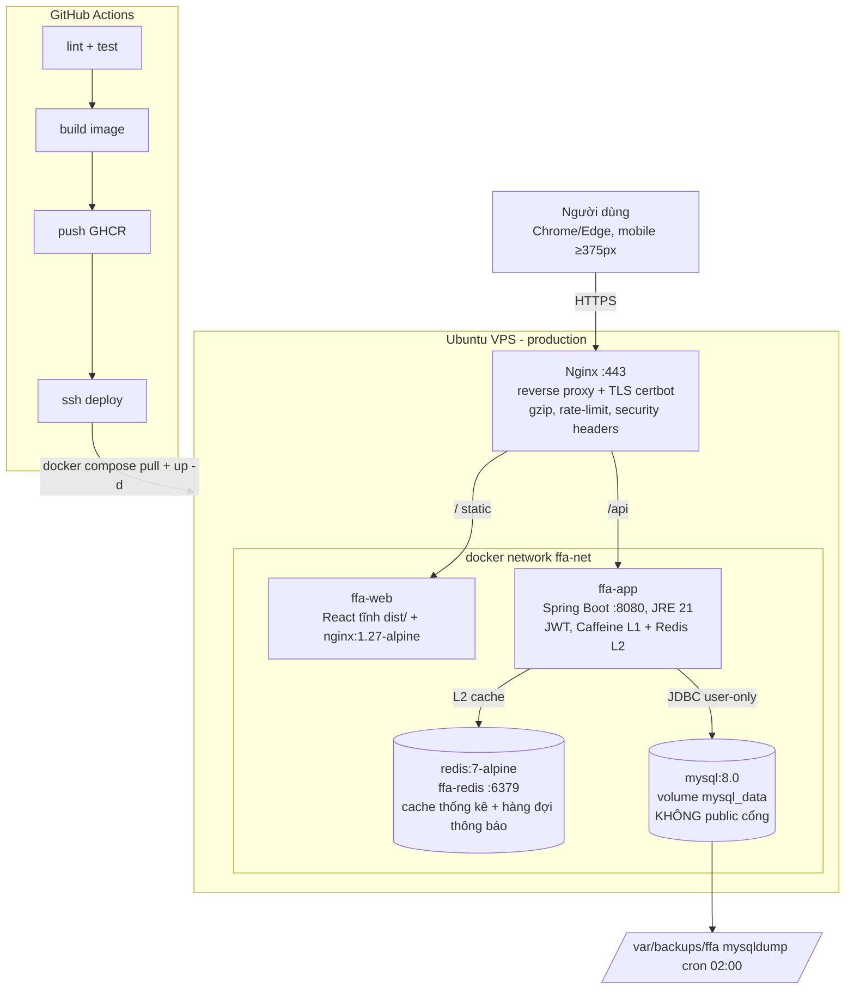
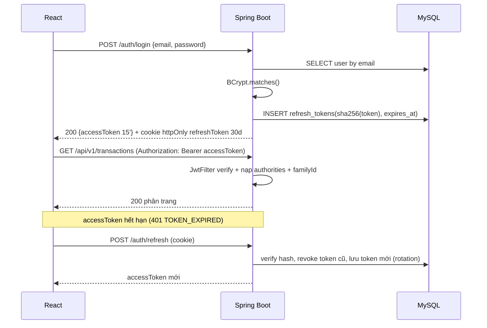

# KIẾN TRÚC HỆ THỐNG — Budglee
**Issue Jira:** DUAN-34 (git flow), DUAN-35 (Docker Compose), DUAN-38 (Entity/Repository/JPA), DUAN-57 (Redis caching) — project **DUAN**, bản xuất [`jira-board.csv`](jira-board.csv) · **Chịu trách nhiệm:** Nguyễn Trường An (B24DTCN181) — Backend Lead · **Ngày:** 22/10/2026, cập nhật 26/10/2026

## 1. Sơ đồ tổng thể (dev & production)



**Môi trường dev** (chính là `docker-compose.yml` trong repo): bỏ Nginx/certbot, mở cổng trực tiếp `web:5173`, `app:8090`, `mysql:3307`, thêm `adminer:8081`; `ffa-redis` chạy trong `ffa-net` ở cả dev và prod (không expose cổng ra host).

## 2. Phân tầng mã nguồn backend

```
vn.ptit.ffa
├── config/      SecurityConfig, CacheConfig, OpenApiConfig, GlobalExceptionHandler
├── web/         @RestController — chỉ DTO in/out, không logic
├── domain/      entity + service (nghiệp vụ, transaction boundary)
├── repository/  Spring Data JPA + projection cho báo cáo
├── security/    JwtFilter, JwtService, FamilyContextResolver (lấy familyId từ token)
└── dto/         request/response record
```

Quy tắc phụ thuộc: `web → domain → repository → db`. Controller không được chạm repository; mọi service nghiệp vụ nhận `familyId` từ `SecurityContext`, không từ request body (NFR-03).

## 3. Luồng xác thực JWT



## 4. Luồng một giao dịch (viết)

```
Form FE → validate (Zod/simple) → POST /api/v1/transactions (Idempotency-Key)
 → JwtFilter → TransactionController → TransactionService @Transactional
 → validate category.kind == type (BR-04) + category.family == token.family (BR-03)
 → repository.save + audit_logs INSERT
 → CacheManager evict "report:{familyId}:{month}" (Redis L2) + entry Caffeine L1 tương ứng
 → 201 + walletBalanceAfter
```

## 5. Chiến lược cache & concurrency
| Đối tượng | Cách | Ghi chú |
|---|---|---|
| Số liệu dashboard / báo cáo tháng (**DUAN-57**) | **Redis là cache L2** — `RedisCacheManager` là `CacheManager` `@Primary`, TTL dashboard 5 phút, reports 10 phút, key prefix `budglee:` | dùng chung cho mọi instance; invalid theo key `(familyId, period)` khi ghi/xóa giao dịch |
| Danh mục, ví (dữ liệu "ít đổi") | **Caffeine là cache L1 in-process** (`caffeineCacheManager`, cache `catalog`), TTL 30 phút, max 500 entry | đọc nhanh trong một node, không qua network |
| Hàng đợi thông báo cảnh báo ngân sách | Redis (container `ffa-redis`, volume `redis_cache` ở prod) | phục vụ UC-13; bảng `notifications` trong MySQL vẫn là bản ghi lưu trữ |
| Sửa đồng thời (optimistic locking) | `@Version` trên `transactions`, `budgets` | chống 2 người cùng sửa hạn mức (AC-03) |
| Khi Redis lỗi / chưa sẵn sàng | `LoggingCacheErrorHandler` (xem `backend/src/main/java/vn/ptit/ffa/config/CacheConfig.java` và `.../cache/LoggingCacheErrorHandler.java`) bắt lỗi GET/PUT/EVICT, log warn rồi **suy giảm về MySQL** | Redis chỉ là tầng tăng tốc, không phải nguồn dữ liệu đúng — mất Redis làm chậm truy vấn chứ **không** làm fail API |

## 6. Bảo mật vận hành
- Không mở cổng MySQL/Redis trên VPS (chỉ đi trong `ffa-net`); backup bằng `docker compose exec mysql mysqldump` chạy trong network.
- `JWT_SECRET`, mật khẩu DB chỉ nằm trong `.env` (dev) và GitHub Secrets (CI/CD) — không bao giờ commit.
- Ảnh uploads lưu `data/uploads/<familyId>/<yyyy>/<mm>/` ngoài image, mount volume, Nginx `X-Accel-Redirect` để bắt buộc qua kiểm tra quyền.
- Nginx: `limit_req zone=api rate=20r/s burst=40`, `ssl_protocols TLSv1.2 TLSv1.3`, HSTS.
- User `deploy` không thuộc nhóm `root`, chỉ có quyền `docker`, SSH chỉ key.

## 7. Cổng & tên service (đăng ký tránh trùng với lớp)
| Service | Container | Cổng trong network | Cổng host dev | Cổng host VPS |
|---|---|---|---|---|
| web | ffa-web | 80 (prod) / 5173 (dev) | 5173 | 8080 → Nginx |
| app | ffa-app | 8080 | 8090 | nội bộ |
| redis | ffa-redis | 6379 | không mở (chỉ trong `ffa-net`) | nội bộ |
| mysql | ffa-mysql | 3306 | 3307 | nội bộ |
| adminer | ffa-adminer | 8080 | 8081 | không mở |
